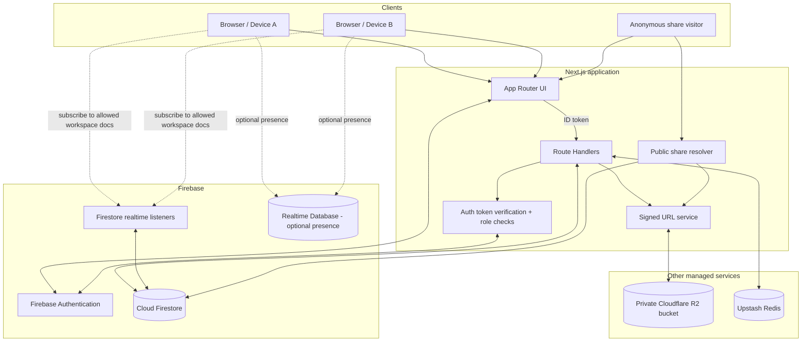
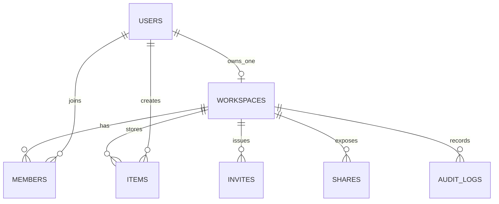

# SyncShelf — System Architecture (Firebase Edition)

**Architecture style:** modular monolith (Next.js) + managed Firebase services  
**Source of truth:** Cloud Firestore  
**Binary object store:** private Cloudflare R2  
**Cache:** disposable Upstash Redis  
**Realtime:** Firestore listeners for item changes; optional RTDB for presence later

## 1. High-level architecture



## 2. Core design principles

1. Firestore holds structured metadata, membership, small text/code, and share records.
2. R2 holds file bytes. Files are private; no permanent public object URLs.
3. Firestore realtime listeners update open clients. No custom socket server is required for the initial feed.
4. Every write passes through a Next.js API route that verifies the Firebase ID token and checks the current role before using Firebase Admin SDK.
5. Client Firestore access is read-only for authorized members. Firestore Security Rules deny client writes; the API is the controlled write path.
6. Share links are separate from membership. Anonymous requests go through a server resolver and can read only their declared scope.
7. Redis is an optimization and abuse-control layer. It never decides authorization and never stores the only copy of data.
8. Never promise zero latency. Realtime updates are delivered over managed network connections and are subject to connectivity and provider limits.

## 3. Authentication and request lifecycle

### 3.1 Browser sign-in

1. User signs in using Firebase Auth email/password or Google provider.
2. Firebase client SDK obtains an ID token.
3. For protected API requests, client sends `Authorization: Bearer <firebase-id-token>`.
4. Next.js route calls `adminAuth.verifyIdToken(token)`.
5. Server derives `uid` from the verified token. Never trust `uid`, role, workspace ID, or owner ID sent by the browser without checking the database.
6. Server reads `workspaces/{workspaceId}/members/{uid}` from Firestore and checks role/status.
7. API performs the requested operation through Firebase Admin SDK only after authorization succeeds.

Optional later improvement: exchange the ID token for a secure, HTTP-only Firebase session cookie for server-rendered protected pages. Do not put ID tokens or service-account credentials in local storage manually.

### 3.2 Role checks

Canonical membership is stored in Firestore. Example roles:

- `owner`: full access and workspace administration.
- `editor`: create, edit, delete, pin, and unpin clipboard items.
- `viewer`: read, search, copy, and download only.

Role helpers must be centralized in `src/lib/authz/`. API routes must call these helpers instead of reimplementing checks independently.

## 4. Data model



Recommended Firestore paths:

```text
users/{uid}
users/{uid}/workspaceMemberships/{workspaceId}

workspaces/{workspaceId}
workspaces/{workspaceId}/members/{memberUid}
workspaces/{workspaceId}/items/{itemId}
workspaces/{workspaceId}/invites/{inviteId}
workspaces/{workspaceId}/shares/{shareId}
workspaces/{workspaceId}/auditLogs/{eventId}
```

### 4.1 One workspace per owner

Use the authenticated UID as the deterministic workspace document ID: `workspaces/{uid}`. The workspace create route runs a Firestore transaction and rejects creation if the document already exists. It creates the workspace and owner membership atomically. This enforces one owned workspace per Firebase account without relying on a fragile client-side check.

A person may still join other workspaces as a member. `users/{uid}/workspaceMemberships/{workspaceId}` is a navigation index and must be written/deleted atomically with the canonical membership record.

### 4.2 `workspaces/{workspaceId}`

```ts
{
  name: string;
  ownerUid: string;
  createdAt: Timestamp;
  updatedAt: Timestamp;
  itemCount?: number;
  storageBytes?: number;
  settings: {
    allowWorkspaceShareLinks: boolean; // false by default
    defaultMemberRole: "viewer";
  };
}
```

### 4.3 `members/{memberUid}`

```ts
{
  uid: string;
  email: string;
  displayName: string;
  role: "owner" | "editor" | "viewer";
  status: "active" | "pending" | "suspended";
  joinedAt: Timestamp;
  updatedAt: Timestamp;
}
```

### 4.4 `items/{itemId}`

```ts
{
  type: "text" | "code" | "image" | "audio" | "link" | "file";
  title: string;
  textContent?: string;          // small content only; enforce app-level cap
  language?: string;             // syntax highlighting for code
  url?: string;                  // links only; validate scheme
  objectKey?: string;            // private R2 object key, not public URL
  thumbnailObjectKey?: string;
  fileName?: string;
  mimeType?: string;
  sizeBytes?: number;
  tags: string[];
  isPinned: boolean;
  createdBy: string;
  createdAt: Timestamp;
  updatedAt: Timestamp;
  deletedAt?: Timestamp | null;
}
```

Do not put raw audio/image/file bytes in Firestore. Keep item documents comfortably below Firestore's document size limit. Set a small text-content cap (for example 200 KB) and store larger bodies as text objects in R2.

### 4.5 Invites

Invite documents store a hash of a high-entropy token, workspace ID, role to grant, optional target email, expiry, max uses, use count, creator, and revocation status. Never store a raw long-lived invite secret.

### 4.6 Share links

Share documents store a token hash, scope (`item` or `workspace`), target item ID where relevant, expiry, revoked flag, created-by UID, and access settings. The raw token is returned once to the owner and must not be stored in Firestore.

### 4.7 Audit log

Record sensitive events such as member invited/removed, role changed, share created/revoked, workspace setting changed, and item delete/restore. Do not log raw share tokens or file contents.

## 5. Data and file flows

### 5.1 Create text/code item

1. Client submits title/content to `POST /api/workspaces/:workspaceId/items` with Firebase ID token.
2. Route verifies the token and reads the member record.
3. Route requires `owner` or `editor`, validates the request with Zod, and enforces text-size limits.
4. Route writes the item using Admin SDK.
5. Route invalidates relevant Redis cache keys.
6. Firestore `onSnapshot()` listeners on authorized clients receive the item change and update the index.

### 5.2 Upload an image/audio/file

1. Client requests `POST /api/workspaces/:workspaceId/uploads/sign` with filename, declared MIME type, and size.
2. Server verifies Firebase ID token, role, workspace storage quota, file size, extension/MIME policy, and rate limit.
3. Server generates a cryptographically random object key and short-lived signed R2 PUT URL.
4. Browser uploads file bytes directly to R2; the app server does not proxy the body.
5. Client calls `POST /api/workspaces/:workspaceId/uploads/finalize` with the upload ID/object key and metadata.
6. Server verifies token/role again, performs R2 `HEAD`, checks size/type, and creates the Firestore item record.
7. Server invalidates cache. Firestore realtime listeners update connected clients.
8. If finalization fails, keep a pending upload record or delete the orphan object safely.

### 5.3 Download or preview

1. Client requests a download URL for an item.
2. Server verifies membership or valid share scope.
3. Server creates a short-lived signed R2 GET URL.
4. Browser downloads the private object directly from R2.

### 5.4 Anonymous share resolution

1. Owner asks the server to create an item- or workspace-scoped share.
2. Server generates a high-entropy random token and stores only `SHA-256(token)` (or an HMAC hash) as the lookup key.
3. Visitor opens `/s/{token}`.
4. Server hashes the token, finds the share record, and checks expiry, revocation, scope, and workspace settings.
5. Server returns only the allowed item(s) and issues temporary R2 URLs after validating the object belongs to that scope.
6. The public endpoint exposes no mutation methods. The raw token is never accepted as an editor credential.

For a workspace share, enforce a page size and make the scope explicit. Do not accidentally return private member lists, emails, audit logs, or workspace settings.

## 6. Firestore Security Rules strategy

Client SDK access is read-only. All mutations go through Next.js API routes using Firebase Admin SDK. Because Admin SDK bypasses Firestore Security Rules, every server route must verify the ID token and membership/role before a write.

Illustrative starting rules (review and test in the Emulator Suite before production):

```javascript
rules_version = '2';
service cloud.firestore {
  match /databases/{database}/documents {
    function signedIn() {
      return request.auth != null;
    }

    function isMember(workspaceId) {
      return signedIn() && exists(
        /databases/$(database)/documents/workspaces/$(workspaceId)/members/$(request.auth.uid)
      );
    }

    match /users/{uid} {
      allow read: if signedIn() && request.auth.uid == uid;
      allow write: if false;
      match /workspaceMemberships/{workspaceId} {
        allow read: if signedIn() && request.auth.uid == uid;
        allow write: if false;
      }
    }

    match /workspaces/{workspaceId} {
      allow read: if isMember(workspaceId);
      allow write: if false;

      match /members/{memberUid} {
        allow read: if isMember(workspaceId);
        allow write: if false;
      }
      match /items/{itemId} {
        allow read: if isMember(workspaceId);
        allow write: if false;
      }
      match /invites/{inviteId} {
        allow read, write: if false;
      }
      match /shares/{shareId} {
        allow read, write: if false;
      }
      match /auditLogs/{eventId} {
        allow read, write: if false;
      }
    }
  }
}
```

This is intentionally a deny-by-default client-write design. The public share route uses the Admin SDK from the server after token validation; anonymous users do not get direct Firestore access. Add tests that prove non-members cannot read, and direct client writes are denied.

## 7. API route outline

```text
POST   /api/workspaces                         create the user's one owned workspace
GET    /api/workspaces                         list workspaces the user belongs to
GET    /api/workspaces/:id/items               paginated initial index (optional Redis cache)
POST   /api/workspaces/:id/items               create text/code/link item
PATCH  /api/workspaces/:id/items/:itemId       update item
DELETE /api/workspaces/:id/items/:itemId       delete item / soft-delete
POST   /api/workspaces/:id/uploads/sign        issue signed R2 upload URL
POST   /api/workspaces/:id/uploads/finalize    verify R2 object and create item metadata
POST   /api/workspaces/:id/items/:itemId/url   issue signed R2 download URL
POST   /api/workspaces/:id/invites             owner creates invite
POST   /api/invites/accept                     signed-in user accepts invite
PATCH  /api/workspaces/:id/members/:uid        owner changes role
DELETE /api/workspaces/:id/members/:uid       owner removes member
POST   /api/workspaces/:id/shares              owner creates share link
DELETE /api/workspaces/:id/shares/:shareId    owner revokes share link
GET    /api/public/shares/:token              resolve anonymous read-only share
```

Every protected route must derive UID from a verified Firebase token. Never accept a claimed role from request JSON.

## 8. Redis cache design

Example keys:

```text
ws:{workspaceId}:summary
ws:{workspaceId}:index:{filter}:{cursor}
share:{tokenHash}:lookup
rate:share:{ipHash}
rate:upload:{uid}
```

Use short TTLs and invalidate after the related mutation. Do not cache permission decisions for long periods. If Redis is down, fall back to Firestore/server validation. Always perform authorization against canonical Firestore records before returning private data or issuing a signed URL.

## 9. Realtime and presence

### MVP

- Use Firestore client SDK `onSnapshot()` on the authenticated workspace's item query.
- Limit the query and paginate; attach listeners only to the visible workspace and required window.
- On create/update/delete, the server writes Firestore and listeners receive the update.
- Unsubscribe listeners when the user leaves a workspace or signs out.

### Optional later WebSocket presence

Use Firebase Realtime Database only for transient online status or typing signals. It must not store the item feed. Design RTDB rules and membership authorization before enabling it; if a membership mirror is used, keep Firestore as canonical and update the mirror through the same owner-only server operation.

Do not add Liveblocks unless users need shared editing cursors, collaborative text editing, or advanced presence that Firestore listeners/RTDB do not cover.

## 10. Suggested source structure

```text
src/
  app/
    (auth)/login/page.tsx
    (auth)/register/page.tsx
    (app)/workspace/[workspaceId]/page.tsx
    (app)/workspace/[workspaceId]/items/[itemId]/page.tsx
    s/[token]/page.tsx
    api/
      workspaces/route.ts
      workspaces/[workspaceId]/items/route.ts
      workspaces/[workspaceId]/items/[itemId]/route.ts
      workspaces/[workspaceId]/uploads/sign/route.ts
      workspaces/[workspaceId]/uploads/finalize/route.ts
      public/shares/[token]/route.ts
  components/
  features/
    auth/
    workspaces/
    members/
    clipboard-items/
    sharing/
    uploads/
  lib/
    firebase/client.ts
    firebase/admin.ts
    auth/verify-id-token.ts
    authz/permissions.ts
    firestore/queries.ts
    r2/client.ts
    r2/signed-urls.ts
    redis/client.ts
    validation/
  hooks/
  types/
firestore.rules
firebase.json
```

## 11. Failure and security cases

- Invalid/expired Firebase ID token: return 401.
- Authenticated but not a member: return 403 and no item data.
- Viewer attempts a write: return 403; do not rely on the UI.
- Revoked/expired share token: return 404 or 410 without disclosing whether a private item exists.
- R2 signed URL expires: request a new URL after re-checking access.
- Redis unavailable: bypass cache and preserve core behavior.
- Firestore quota exhausted: show a controlled error; do not silently lose changes.
- Upload finalization fails: mark pending/orphan and allow retry/cleanup.
- Member removed: new requests fail immediately; signed URLs already issued remain usable only until their short expiry. Keep expiry short.
- Malicious MIME/type: validate content policy and never render untrusted HTML/SVG inline by default.

## 12. Performance rules

- No giant unpaginated item query.
- Do not subscribe to the entire database.
- Store thumbnail objects separately; lazy-load media previews.
- Use optimistic UI only when reconciliation/rollback exists.
- Send metadata through Firestore, not binary files.
- Keep Realtime Database and Redis optional; Firestore must remain the canonical database.
- Do not promise literal zero delay; target fast perceived updates and measure actual latency.
