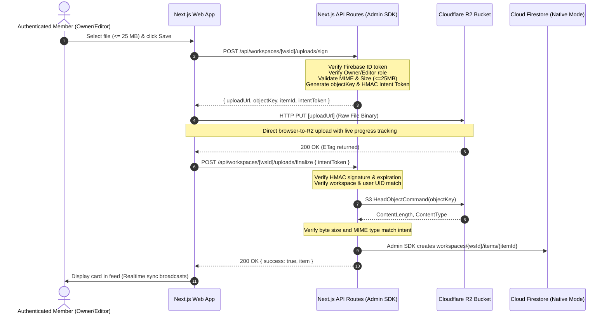

# SyncShelf — Milestone 7: Private File Storage with Cloudflare R2

## 1. Overview & Architecture

Milestone 7 introduces secure, private binary file and media storage to SyncShelf using **Cloudflare R2** object storage. The design preserves the zero-trust security architecture established in prior milestones:

1. **Zero Client-Side Firestore Writes**: The Firestore security rules continue to reject all client-side write attempts (`allow write: if false;`). Metadata is written solely by the Next.js server via Firebase Admin SDK.
2. **Direct Browser-to-R2 Upload**: Large binary payloads (up to 25 MB) never traverse the Next.js server runtime, eliminating memory spikes and server bandwidth bottlenecks.
3. **Cryptographically Signed Upload Intents**: The server issues tamper-proof HMAC-SHA256 signed intent tokens during the sign phase, ensuring clients cannot forge object keys, inflate file sizes, alter MIME types, or target unowned workspaces.
4. **Server-Side S3 HEAD Verification**: Before any document is persisted to Firestore, the server executes an S3 `HeadObjectCommand` directly against Cloudflare R2 to verify object existence, exact byte size, and MIME type match.
5. **Completely Private Storage**: R2 buckets have zero public access. Viewing or downloading media requires a short-lived presigned GET URL (1-hour expiration) generated exclusively by authorized workspace members.

---

## 2. Upload & Verification Sequence



---

## 3. Role-Based Access Control (RBAC) Matrix

| Action | Owner | Editor | Viewer | Non-Member / Unauthenticated |
| :--- | :---: | :---: | :---: | :---: |
| **Request Presigned Upload URL** (`POST /uploads/sign`) | ✅ Allowed | ✅ Allowed | ❌ Denied (403) | ❌ Denied (401/403) |
| **Upload Binary to R2** (Presigned PUT) | ✅ Allowed | ✅ Allowed | ❌ Denied (No URL) | ❌ Denied (No URL) |
| **Finalize Upload & Create Metadata** (`POST /uploads/finalize`) | ✅ Allowed | ✅ Allowed | ❌ Denied (403) | ❌ Denied (401/403) |
| **Request Presigned GET / Download URL** (`GET/POST /items/[id]/url`) | ✅ Allowed | ✅ Allowed | ✅ Allowed | ❌ Denied (401/403) |
| **View Image Thumbnail / Play Audio** | ✅ Allowed | ✅ Allowed | ✅ Allowed | ❌ Denied (401/403) |
| **Delete Item & Storage Object** (`DELETE /items/[id]`) | ✅ Allowed | ✅ Allowed | ❌ Denied (403) | ❌ Denied (401/403) |

---

## 4. Supported File Types & Constraints

- **Maximum File Size**: 25 MB (`26,214,400 bytes`).
- **Images**: `image/png`, `image/jpeg`, `image/jpg`, `image/gif`, `image/webp`, `image/svg+xml`.
- **Audio**: `audio/mpeg`, `audio/mp3`, `audio/wav`, `audio/ogg`, `audio/webm`, `audio/aac`, `audio/flac`.
- **Documents & Archives**: `application/pdf`, `text/plain`, `text/markdown`, `text/csv`, `application/json`, `application/zip`, Microsoft Office documents (`.docx`, `.xlsx`, `.pptx`).

---

## 5. Storage Key Scoping & Security

All object keys in Cloudflare R2 are strictly partitioned by workspace:

```text
workspaces/{workspaceId}/items/{itemId}/{timestamp}-{sanitizedFileName}
```

- **Workspace Isolation**: Object keys always start with `workspaces/{workspaceId}/`.
- **Tamper Protection**: Intent tokens are signed with HMAC-SHA256 using the server's private key. Modification of the `workspaceId`, `itemId`, `expectedSizeBytes`, or `objectKey` causes instant cryptographic signature invalidation.
- **Cleanup on Deletion**: When an Owner or Editor deletes an item via `DELETE /api/workspaces/[workspaceId]/items/[itemId]`, the server invokes S3 `DeleteObjectCommand` against R2 prior to removing the Firestore document.

---

## 6. Cloudflare R2 Setup Guide

To connect your live Cloudflare R2 bucket to SyncShelf:

### Step 1: Create a Private Bucket
1. Log in to your [Cloudflare Dashboard](https://dash.cloudflare.com/).
2. In the left navigation, select **R2 Storage** > **Overview**.
3. Click **Create bucket**.
4. Enter bucket name: e.g. `syncshelf-storage-prod`.
5. Select location hint: **Asia Pacific (APAC)** (matching Firestore `asia-south1`).
6. Click **Create Bucket**.
7. **Important**: Keep the bucket strictly private. Do **not** enable Public Development URL or connect a custom public domain.

### Step 2: Configure CORS on the Bucket
For the web browser to upload directly via presigned PUT, configure CORS on the bucket:
1. In the R2 bucket page, navigate to the **Settings** tab.
2. Scroll to **CORS Policy** and click **Add CORS policy** (or Edit).
3. Paste the following JSON policy:

```json
[
  {
    "AllowedOrigins": [
      "http://localhost:3000",
      "https://your-production-domain.com"
    ],
    "AllowedMethods": [
      "GET",
      "PUT",
      "HEAD"
    ],
    "AllowedHeaders": [
      "*"
    ],
    "ExposeHeaders": [
      "ETag",
      "Content-Length",
      "Content-Type"
    ],
    "MaxAgeSeconds": 3600
  }
]
```
4. Click **Save**.

### Step 3: Create R2 API Tokens
1. From the **R2 Storage** > **Overview** page, click **Manage R2 API Tokens** in the right sidebar.
2. Click **Create API token**.
3. Set Token Name: e.g. `syncshelf-app-token`.
4. Permissions: Select **Object Read & Write**.
5. Specify bucket: Apply to specific bucket (e.g. `syncshelf-storage-prod`) or all buckets.
6. Click **Create API Token**.
7. Copy the following credentials immediately:
   - **Account ID** (found on the R2 overview page).
   - **Access Key ID**.
   - **Secret Access Key**.

### Step 4: Add to `.env.local`
Add the following 5 variables to your local `.env.local` file:

```env
# Cloudflare R2 File Storage
R2_ACCOUNT_ID="your_cloudflare_account_id"
R2_ACCESS_KEY_ID="your_r2_access_key_id"
R2_SECRET_ACCESS_KEY="your_r2_secret_access_key"
R2_BUCKET_NAME="syncshelf-storage-prod"
R2_ENDPOINT="https://your_cloudflare_account_id.r2.cloudflarestorage.com"
MAX_UPLOAD_SIZE_BYTES=26214400
```

---

## 7. Automated Test & Verification Report

| Test Suite | Tests | Result | Details |
| :--- | :---: | :---: | :--- |
| **Permissions RBAC** (`tests/permissions.test.ts`) | 13/13 | ✅ Passed | Owner/Editor/Viewer role gating |
| **Token Verification** (`tests/token-verification.test.ts`) | 4/4 | ✅ Passed | Server ID token verification & revocation |
| **Workspace Isolation** (`tests/workspace-rules.test.ts`) | 7/7 | ✅ Passed | Multi-workspace membership & scoping |
| **Clipboard Items API** (`tests/items-api.test.ts`) | 14/14 | ✅ Passed | CRUD, cursor pagination, filtering, search |
| **Realtime Hook** (`tests/realtime-hook.test.ts`) | 5/5 | ✅ Passed | Horizon window, deduplication, sorting |
| **Cloudflare R2 API & Storage** (`tests/r2-uploads.test.ts`) | 15/15 | ✅ Passed | HMAC intent tokens, 25MB limit, MIME filter, S3 HEAD check, presigned GET, deletion cleanup |
| **Firestore Rules Writes** (`tests/firestore-rules-writes.test.ts`) | 12/12 | ✅ Passed | Zero client writes, owner/editor/viewer write denial |
| **Firestore Rules Reads** (`tests/firestore-rules-reads.test.ts`) | 21/21 | ✅ Passed | Restrictive workspace member reads |
| **Realtime Synchronization** (`tests/realtime-sync.test.ts`) | 7/7 | ✅ Passed | Live listener updates, multi-tab sync |
| **Total Automated Tests** | **98/98** | **100% Passed** | **0 failures** |

### Quality Gates

- `npm run typecheck`: **0 errors** (TypeScript 5.7 clean).
- `npm run lint`: **0 errors** (ESLint Next.js clean).
- `npm run build`: **Compiled successfully in 36.0s** (All 10 routes generated).

---

## 8. Summary of Created & Updated Files

- `src/lib/r2/client.ts`: Server-only S3 client singleton targeting Cloudflare R2.
- `src/lib/r2/intent-token.ts`: HMAC-SHA256 cryptographic upload intent generator and verifier.
- `src/lib/r2/signed-urls.ts`: Presigned PUT/GET generator, S3 HEAD verification, and R2 deletion helper.
- `src/lib/validation/item.ts`: Extended data model with `image`, `audio`, `file`, MIME validations, and upload schemas.
- `src/app/api/workspaces/[workspaceId]/uploads/sign/route.ts`: Endpoint generating presigned PUT and signed intent token.
- `src/app/api/workspaces/[workspaceId]/uploads/finalize/route.ts`: Endpoint verifying R2 HEAD before persisting metadata.
- `src/app/api/workspaces/[workspaceId]/items/[itemId]/url/route.ts`: Endpoint generating presigned GET URLs for Viewer, Editor, Owner.
- `src/app/api/workspaces/[workspaceId]/items/[itemId]/route.ts`: Enhanced DELETE endpoint with automated R2 object cleanup.
- `src/features/clipboard/r2-upload-client.ts`: Client upload helper with direct-to-R2 upload and progress tracking.
- `src/features/clipboard/quick-capture-modal.tsx`: Added drag-and-drop file upload tab with progress bar.
- `src/features/clipboard/clipboard-card.tsx`: Added image thumbnail preview, audio player, and file download support.
- `src/features/clipboard/clipboard-feed.tsx`: Added filter tabs for Images, Audio, and Files.
- `tests/r2-uploads.test.ts`: 15 comprehensive unit & API integration tests.
- `docs/MILESTONE_7_FILE_STORAGE.md`: Complete documentation and Cloudflare R2 setup instructions.
