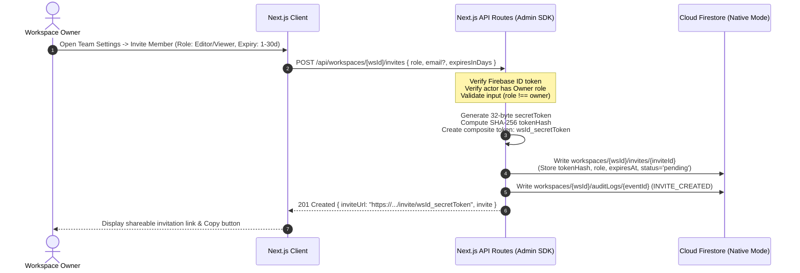
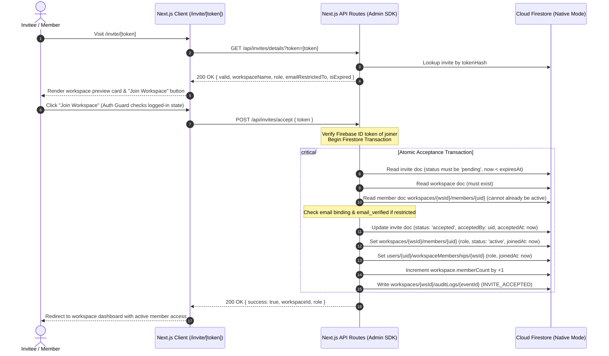
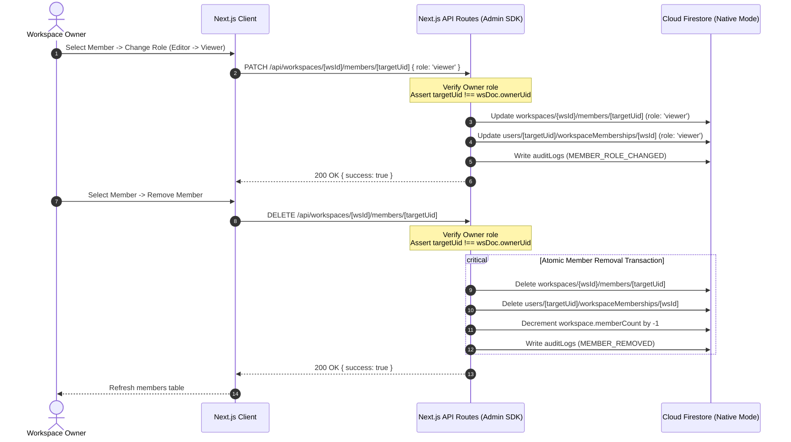

# SyncShelf — Milestone 8: Team Management & Invitations

## 1. Overview & Architecture

Milestone 8 introduces team collaboration, role management, invitation links, and immutable administrative audit logging to SyncShelf. The architecture strictly maintains the security principles and data guarantees established in Milestones 1 through 7:

1. **Strict Single-Workspace Ownership**: Each authenticated user can own at most one workspace (`workspaces/{ownerUid}`). A user's owned workspace ID is deterministically pegged to their Firebase UID.
2. **Multi-Workspace Membership**: Users can be invited and join multiple workspaces across SyncShelf without restriction. Membership indexes are maintained bidirectionally:
   - Workspace member record: `workspaces/{workspaceId}/members/{uid}`
   - User reverse membership index: `users/{uid}/workspaceMemberships/{workspaceId}`
3. **Role Hierarchy & Separation of Concerns**:
   - **Owner**: Full workspace governance. Invites members, assigns Editor or Viewer roles, updates member roles, removes members, revokes invitations, and reviews administrative audit logs. Workspace owners can never be demoted, removed, or invited.
   - **Editor**: Can create, edit, pin, upload media, and delete clipboard items. Cannot access team management, cannot invite or alter roles, and cannot inspect audit history.
   - **Viewer**: Read-only access to clipboard items and files. Cannot mutate workspace content, cannot manage team members.
4. **Cryptographic Invitation Tokens**:
   - High entropy: 32 cryptographically secure random bytes (64 hexadecimal characters, providing 256 bits of entropy).
   - Zero plaintext storage: Only the SHA-256 hash (`tokenHash`) of the secret token is stored in Cloud Firestore. Plaintext secrets are never persisted and never logged.
   - Composite token format: `${workspaceId}_${secretToken}` enables $O(1)$ direct document lookup while supporting fallback queries.
5. **Atomic Transactions & Anti-Replay Security**:
   - All acceptance, member removals, and revocations execute inside atomic Firestore transactions (`adminDb.runTransaction`).
   - Prevents race conditions, concurrent replay attacks, and duplicate memberships.
   - Automatically maintains `memberCount` counters and reverse index synchrony.
6. **Email Binding & Verification Enforcement**:
   - Invitations can optionally be restricted to a specific email address.
   - Acceptance strictly enforces both email address equality and Firebase Authentication email verification (`email_verified === true`).
7. **Immutable Audit Logging**:
   - Sensitive administrative operations (`INVITE_CREATED`, `INVITE_REVOKED`, `INVITE_ACCEPTED`, `MEMBER_ROLE_CHANGED`, `MEMBER_REMOVED`) are recorded server-side into `workspaces/{workspaceId}/auditLogs/{eventId}`.
   - Accessible strictly to workspace Owners.

---

## 2. Sequence Diagrams

### 2.1 Invitation Creation & Link Generation



### 2.2 Invitation Acceptance & Atomic Membership Mutation



### 2.3 Member Removal & Role Modification



---

## 3. Role-Based Access Control (RBAC) Matrix

| Operation | Owner | Editor | Viewer | Non-Member / Unauthenticated |
| :--- | :---: | :---: | :---: | :---: |
| **Create Invitation** (`POST /invites`) | ✅ Allowed | ❌ Denied (403) | ❌ Denied (403) | ❌ Denied (401/403) |
| **List Pending Invites** (`GET /invites`) | ✅ Allowed | ❌ Denied (403) | ❌ Denied (403) | ❌ Denied (401/403) |
| **Revoke Invitation** (`DELETE /invites/[id]`) | ✅ Allowed | ❌ Denied (403) | ❌ Denied (403) | ❌ Denied (401/403) |
| **Preview Invite Metadata** (`GET /invites/details`) | ✅ Allowed | ✅ Allowed | ✅ Allowed | ✅ Allowed (Public Preview) |
| **Accept Invitation** (`POST /invites/accept`) | ❌ N/A (Already Owner) | ✅ Allowed (New WS) | ✅ Allowed (New WS) | ❌ Denied (Must Sign In) |
| **List Workspace Members** (`GET /members`) | ✅ Allowed | ✅ Allowed | ✅ Allowed | ❌ Denied (401/403) |
| **Update Member Role** (`PATCH /members/[uid]`) | ✅ Allowed | ❌ Denied (403) | ❌ Denied (403) | ❌ Denied (401/403) |
| **Remove Workspace Member** (`DELETE /members/[uid]`) | ✅ Allowed | ❌ Denied (403) | ❌ Denied (403) | ❌ Denied (401/403) |
| **View Audit Logs** (`GET /audit-logs`) | ✅ Allowed | ❌ Denied (403) | ❌ Denied (403) | ❌ Denied (401/403) |
| **Change/Demote Owner** | ❌ Blocked (400) | ❌ Blocked (403) | ❌ Blocked (403) | ❌ Blocked (401/403) |
| **Remove Workspace Owner** | ❌ Blocked (400) | ❌ Blocked (403) | ❌ Blocked (403) | ❌ Blocked (401/403) |

---

## 4. Firestore Data Models & Schemas

### 4.1 Invitation Document (`workspaces/{workspaceId}/invites/{inviteId}`)

```typescript
export interface StoredWorkspaceInvite {
  id: string;                      // UUIDv4
  workspaceId: string;             // Owner's UID
  tokenHash: string;               // SHA-256 hex string (64 characters)
  role: "editor" | "viewer";       // Invitations CANNOT grant 'owner'
  email: string | null;            // Optional email restriction (lowercase)
  status: "pending" | "accepted" | "revoked";
  createdBy: string;               // Inviter UID
  createdAt: FieldValue;           // Server timestamp
  expiresAt: Timestamp;            // Configurable 1 to 30 days (default: 7)
  acceptedBy: string | null;       // Joiner UID upon acceptance
  acceptedAt: FieldValue | null;   // Timestamp upon acceptance
  revokedAt: FieldValue | null;    // Timestamp upon revocation
  revokedBy: string | null;        // Owner UID who revoked
}
```

### 4.2 Workspace Member Document (`workspaces/{workspaceId}/members/{uid}`)

```typescript
export interface WorkspaceMemberDoc {
  uid: string;                     // Firebase Auth UID
  role: "owner" | "editor" | "viewer";
  status: "active" | "suspended";
  email: string | null;
  displayName: string | null;
  joinedAt: FieldValue | Timestamp;
  invitedBy?: string;              // UID of user who issued invite
}
```

### 4.3 Reverse Membership Index (`users/{uid}/workspaceMemberships/{workspaceId}`)

```typescript
export interface UserWorkspaceMembershipDoc {
  workspaceId: string;
  role: "owner" | "editor" | "viewer";
  joinedAt: FieldValue | Timestamp;
}
```

### 4.4 Audit Log Document (`workspaces/{workspaceId}/auditLogs/{eventId}`)

```typescript
export interface StoredAuditLog {
  id: string;                      // UUIDv4
  workspaceId: string;
  actorUid: string;                // UID executing the action
  action:
    | "INVITE_CREATED"
    | "INVITE_REVOKED"
    | "INVITE_ACCEPTED"
    | "MEMBER_ROLE_CHANGED"
    | "MEMBER_REMOVED";
  targetUid: string | null;        // Affected member UID (if applicable)
  inviteId: string | null;         // Related invitation ID (if applicable)
  metadata: Record<string, any>;   // Additional contextual attributes
  createdAt: FieldValue | string;  // Server timestamp
}
```

---

## 5. API Route Endpoints

| Method | Endpoint | Auth Required | Role Required | Description |
| :--- | :--- | :---: | :---: | :--- |
| `POST` | `/api/workspaces/[wsId]/invites` | ✅ Yes | `owner` | Issues new cryptographically hashed invite link |
| `GET` | `/api/workspaces/[wsId]/invites` | ✅ Yes | `owner` | Lists active and historical invites (strips tokenHash) |
| `DELETE` | `/api/workspaces/[wsId]/invites/[id]` | ✅ Yes | `owner` | Revokes a pending invitation atomically |
| `GET` | `/api/invites/details?token=...` | ❌ No | Any (Public) | Resolves invite workspace name, role & validity |
| `POST` | `/api/invites/accept` | ✅ Yes | Any Authenticated | Accepts invite & creates dual membership docs |
| `GET` | `/api/workspaces/[wsId]/members` | ✅ Yes | `owner`, `editor`, `viewer` | Lists all members in the workspace |
| `PATCH` | `/api/workspaces/[wsId]/members/[uid]` | ✅ Yes | `owner` | Updates member role (rejects demoting owner) |
| `DELETE` | `/api/workspaces/[wsId]/members/[uid]` | ✅ Yes | `owner` | Removes member and cleans up reverse index |
| `GET` | `/api/workspaces/[wsId]/audit-logs` | ✅ Yes | `owner` | Chronological administrative audit logs |

---

## 6. Frontend UI Implementation

1. **Team Management View (`src/features/team/team-management-view.tsx`)**:
   - Integrated into the main application feed when clicking the **Members** filter in the sidebar.
   - Provides 3 sub-views via accessible navigation tabs:
     - **Members Tab**: Table of team members with avatar initials, role pills, join date, Owner indicator, role switch dropdown for owners, and member removal modal.
     - **Pending Invites Tab**: Live listing of pending and active invites with status tags, expiration countdowns, and instant revocation buttons.
     - **Audit History Tab**: Chronological audit trail showing actor, action, timestamp, target, and formatted change metadata.
2. **Invite Member Modal (`src/features/team/invite-modal.tsx`)**:
   - Role selection: **Editor** (read + write) or **Viewer** (read-only). Owner cannot be selected.
   - Expiration selector: 1 day, 3 days, 7 days (default), 14 days, or 30 days.
   - Optional email restriction input with inline validation.
   - Generates complete shareable URL with one-click copy and feedback toast.
3. **Public Invitation Landing Page (`src/app/invite/[token]/page.tsx`)**:
   - Resolves invitation metadata without requiring upfront login (`/api/invites/details`).
   - Displays workspace name, assigned role, and expiration badge.
   - Auth guard check: If unauthenticated, displays "Sign in to accept" button preserving invite return URL.
   - Email restriction warnings: Alerts user if logged in with a different email than the invitation target or if email is unverified.
   - Atomic acceptance action: Redirects user straight into the newly joined workspace upon confirmation.

---

## 7. Firestore Security Rules

Client-side security rules in `firestore.rules` have been updated with explicit denial rules for the new subcollections:

```javascript
rules_version = '2';
service cloud.firestore {
  match /databases/{database}/documents {
    
    // Existing workspace & item read rules ...
    match /workspaces/{workspaceId} {
      allow read: if isWorkspaceMember(workspaceId);
      allow write: if false; // All mutations via Admin SDK

      // Explicitly reject direct client access to administrative subcollections
      match /invites/{inviteId} {
        allow read, write: if false;
      }

      match /auditLogs/{eventId} {
        allow read, write: if false;
      }
    }

    // Default global fallback: deny everything
    match /{document=**} {
      allow read, write: if false;
    }
  }
}
```

---

## 8. Test Verification Matrix

### 8.1 Vitest Unit & API Route Suite (`tests/team-invitations.test.ts`)

| # | Test Case Description | Requirement Tested | Result |
| :-: | :--- | :--- | :---: |
| 1 | Generates 32-byte high-entropy tokens and computes SHA-256 hash | Token entropy & SHA-256 | ✅ PASS |
| 2 | Parses composite shareable tokens correctly (`<wsId>_<secret>`) | O(1) direct lookup parsing | ✅ PASS |
| 3 | Owner creates Editor invitation (201 Created, secret not stored) | Req 1, 2 & 5 | ✅ PASS |
| 4 | Owner creates Viewer invitation (201 Created, role: viewer) | Req 1 & 2 | ✅ PASS |
| 5 | Editor and Viewer cannot create invitations (403 Forbidden) | Req 3 & 4 | ✅ PASS |
| 6 | Unauthenticated user cannot create invitation (401 Unauthorized) | Auth enforcement | ✅ PASS |
| 7 | Rejects invitations with role 'owner' (400 Bad Request) | Role safety invariant | ✅ PASS |
| 8 | Owner lists invitations; raw secret and tokenHash stripped | Req 6 | ✅ PASS |
| 9 | Editor and Viewer cannot list invitations (403 Forbidden) | RBAC boundary | ✅ PASS |
| 10 | Owner revokes invite; status set to revoked & audit logged | Req 8 | ✅ PASS |
| 11 | Non-owner cannot revoke invitation (403 Forbidden) | RBAC boundary | ✅ PASS |
| 12 | Revoking non-existent invitation returns 404 Not Found | Error handling | ✅ PASS |
| 13 | Rejects revoking an invitation that has already been accepted (400) | Anti-tamper | ✅ PASS |
| 14 | Public invite preview: returns 200 with workspaceName and role | Landing page preview | ✅ PASS |
| 15 | Public invite preview: returns isExpired: true and status: expired | Expiry preview | ✅ PASS |
| 16 | Public invite preview: returns 404 for non-existent token | Error handling | ✅ PASS |
| 17 | Only authenticated users can accept invitations (401) | Req 10 | ✅ PASS |
| 18 | Expired invitations are rejected (400 Bad Request) | Req 7 | ✅ PASS |
| 19 | Acceptance of revoked invitation fails (400 Bad Request) | Anti-replay | ✅ PASS |
| 20 | Acceptance of already-accepted invitation fails (400 Bad Request) | Single-use invariant | ✅ PASS |
| 21 | Email-restricted invite: mismatching email rejected (403) | Req 11 | ✅ PASS |
| 22 | Email-restricted invite: matching email but unverified rejected (403) | Verification check | ✅ PASS |
| 23 | Existing active member accepts invite returns 409 Conflict | Duplicate member guard | ✅ PASS |
| 24 | Atomic acceptance writes member doc, reverse index, increments count & logs audit | Req 12, 13, 14, 15, 16 | ✅ PASS |
| 25 | Owner updates member role; role updated in member doc | Req 18 | ✅ PASS |
| 26 | Owner cannot change or demote own role (400 Bad Request) | Req 19 | ✅ PASS |
| 27 | Non-owner cannot update member roles (403 Forbidden) | RBAC boundary | ✅ PASS |
| 28 | Owner cannot remove self from owned workspace (400 Bad Request) | Req 20 | ✅ PASS |
| 29 | Regular member removal deletes member doc, reverse index & decrements count | Req 21 | ✅ PASS |
| 30 | Non-owner cannot remove member (403 Forbidden) | RBAC boundary | ✅ PASS |
| 31 | Non-owner cannot access audit logs (403 Forbidden) | Req 22 | ✅ PASS |
| 32 | Owner retrieves chronological audit records (200 OK) | Req 23 | ✅ PASS |
| 33 | Listing members returns 200 for Viewer (all members can view team) | Member visibility | ✅ PASS |

### 8.2 Full Test Suite Summary

- **`npm test`**: **88 / 88 tests passing** (7 test suites: permissions, token verification, workspace rules, items API, realtime hook, R2 uploads, team invitations).
- **`npm run test:rules`**: **42 / 42 tests passing** (against live Firestore emulator: read enforcement, zero client write trust, realtime snapshot sync).
- **Total Automated Tests**: **130 / 130 tests passing**.
- **`npm run typecheck`**: **Clean (0 errors)**.
- **`npm run lint`**: **Clean (0 warnings, 0 errors)**.
- **`npm run build`**: **Clean production compilation in 34.7s** (`.next_prod` generated with 18 optimized routes).
